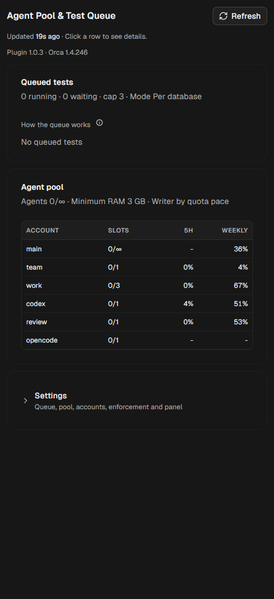
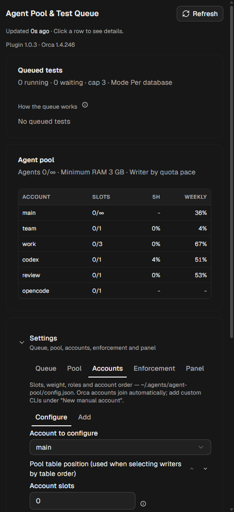
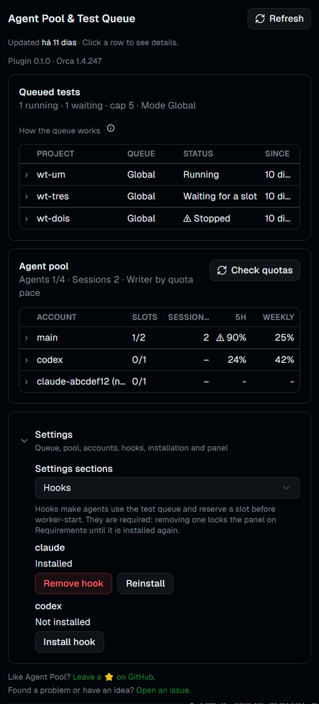
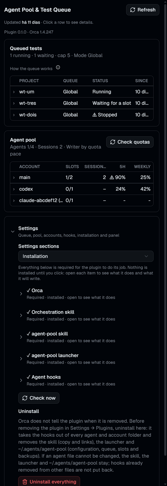

# Agent Pool & Test Queue for Orca

[](https://github.com/VictorStochero/orca-agent-pool/actions/workflows/ci.yml)


An [Orca](https://github.com/stablyai/orca) plugin that lets many coding agents share one machine safely. It gives you an **agent pool** (which account should do the next task, with slots per account), a **test queue** for any language (so parallel agents don't overload the machine or corrupt each other's test databases) and a **panel** in Orca to watch and configure both.



## Contents
- [Features](#features) · [Requirements](#requirements) · [Install](#install) · [How agents use it](#how-agents-use-it)
- [The panel](#the-panel) · [The test queue](#the-test-queue) · [Configuration](#configuration)
- [What it changes on your machine](#what-it-changes-on-your-machine) · [Quota and privacy](#quota-and-privacy)
- [CLI](#cli) · [Troubleshooting](#troubleshooting) · [Uninstall](#uninstall) · [Development](#development) · [Changelog](#changelog)

## Features
- **Agent pool**: your agent accounts (Claude Code, Codex, OpenCode, Antigravity, …) with **slots**, **weight** and **roles**. The writer for each task is the account with the most quota left × its weight, or the first one in your order. Quota follows the separate limit of the model the account uses (for example Fable, or Antigravity's Gemini groups), and `writer`/`second` print the model to pass as `--model`. Accounts Orca already knows join the list automatically but turned off: they get no work, and spend no quota, until you turn them on in Settings → Accounts. Extra CLIs, such as a second Claude login in its own `CLAUDE_CONFIG_DIR`, are added by hand.
- **Test queue**: every test run waits for its turn, per machine and per shared resource, for Laravel (artisan/Pest), Python (pytest), JavaScript/TypeScript (vitest, jest, npm/pnpm/yarn/bun), Go, Rust, .NET and RSpec.
- **Hooks**: a hook for Claude Code and Codex that turns away a bare test command and tells the agent the queued form, and turns away `orca orchestration worker-start` without a pending `res-` slot reservation, so the rules hold even when an agent forgets them.
- **Nothing without your click**: the launcher, the skill and the hooks are installed only when you press **Install** on the Requirements screen or in Settings → Hooks, after opening the item to read what it does and which files it writes.
- **Panel**: tests waiting and running, the pool with quotas, alerts (for example an account that must log in again) and every setting, in English or Portuguese following Orca's language.
- Works with Orca's native orchestration (`orca orchestration worker-start`, `send`, `worker_done`).

## Requirements
- Orca **1.4.248** or newer. The plugin's CLI runs on Orca's own runtime: no separate Node.js, Python or Git Bash.
- Windows, macOS or Linux.

## Install
1. In Orca, open **Settings → Plugins** and install **Agent Pool & Test Queue** from the catalog.
   Not listed yet? Choose **Add plugin → From a Git URL…** and paste `https://github.com/VictorStochero/orca-agent-pool#v1.0.14`.
2. Approve the access it asks for (a trusted worker and its own storage).
3. Open the **Agent Pool** panel. Activation only creates the plugin's own folder `~/.agents/agent-pool/` (`config.json` and `state/`) and writes nothing else.
4. The panel shows the **Requirements** screen. Each item is a row you open to see what it does, why the plugin needs it and the exact files a click will write; its **Install** button is inside the open row. All of them are required for the plugin to do its job:
   1. **Orca** 1.4.248 or newer;
   2. Orca's own **orchestration** skill (Orca installs it in its skills folder);
   3. the **agent-pool skill**, copied to `~/.agents/skills/agent-pool` and linked into the skills folder of each agent of your active accounts (a copy you edited is not replaced: to reinstall it, delete `~/.agents/skills/agent-pool` and press **Install**);
   4. the **launcher** `~/.agents/bin/agent-pool` (plus `agent-pool.cmd` on Windows), the command agents and hooks call;
   5. the **agent hooks** (see [below](#what-it-changes-on-your-machine)).

The panel stays on Requirements until every item is installed, and goes back to it whenever one goes missing: a hook removed, a new account whose folder still lacks the hook or the skill link, or the launcher left pointing at an older plugin or Orca version after an update (click **Install** again). Agents always call the launcher by its full path; add `~/.agents/bin` to your `PATH` if you want the short name `agent-pool` in your own terminal.

## How agents use it
The `agent-pool` skill teaches this to the agents; this is what a coordinator does around each worker:

```sh
# 1. pick the writer and reserve its slot (exit 75 = pool full: wait and try again)
~/.agents/bin/agent-pool writer --reserve task-42
#    → claude-b (pace 15.6 · 33% free, resets in 18h) · weight 5 · reserve res-task-42

# 2. start the worker on that account, then hand the slot to the real dispatch
orca orchestration worker-start ...
~/.agents/bin/agent-pool slot swap res-task-42 <dispatch-id>

# 3. inside the worker, every test goes through the queue
~/.agents/bin/agent-pool test -- php artisan test --filter=Orders

# 4. when the worker is done
~/.agents/bin/agent-pool slot release <dispatch-id>
```

A reservation that is never swapped expires after 10 minutes, and a slot whose dispatch Orca reports as finished is freed on the next read. With the hooks installed, a bare `php artisan test` is refused with the exact command to run instead.

## The panel
| Settings · Accounts | Settings · Hooks | Settings · Installation |
|---|---|---|
|  |  |  |

- **Tests in the queue**: what is running and waiting, per queue, with the process and how long it has waited.
- **Agent pool**: slots in use per account (`2/∞` for an account without its own limit), open Claude sessions per account (including the ones you open yourself; a session without `--agent` is display only, while an agent session opened with `--agent <role>` takes a slot for as long as it stays open), 5-hour and weekly quota, and the details of each account on click.
- **Settings**: a section selector for the queue, the pool, the accounts (**Configure** an account or **Add** a custom one), **Hooks** (install, reinstall or remove the hook per agent; removing one locks the panel on Requirements again), **Installation** (the requirement rows, always visible, **Check now** to read them again on demand, and **Uninstall everything**) and the panel itself.

## The test queue
Run tests with `agent-pool test` (detects the runner) or `agent-pool test -- <command>`.

| Mode | Behaviour |
|---|---|
| **Per database** (default) | one queue per shared resource. A database (`host:port/name`) gets one slot, so tests on the same database wait for each other and different databases run in parallel. The general queue and container runners use `fila.vagas` slots. |
| **Global** | one queue for the whole machine |
| **Per project** | one queue per project (`fila.vagas_projeto` slots each) |

The machine-wide cap (`fila.teto`) applies in every mode. A new mode applies to tests started afterwards (a test that already has a slot keeps its queue until it ends); new slot counts and cap also apply to tests already waiting. The resource comes, in order, from the project's `.orca/agent-pool.json` (`{"recurso": "postgres:5433"}`), `DATABASE_URL`, `DB_HOST`/`DB_PORT`/`DB_DATABASE` (also when set inline, as in `DB_DATABASE=x php artisan test`), a container runner, or falls back to the general queue.

| Detected by | Runner | Parallelism (`fila.processos`) |
|---|---|---|
| `artisan` | `php artisan test` | `--parallel --processes=N` |
| `pyproject.toml` / `pytest.ini` / `requirements*.txt` | `pytest` (uv, poetry, pipenv or .venv) | `-n N` when pytest-xdist is installed |
| `package.json` | the `test` script (pnpm, yarn, bun or npm) | `--maxWorkers=N` |
| `go.mod` | `go test ./...` | `-p N` |
| `Cargo.toml` | `cargo test` | `-- --test-threads=N` |
| `*.csproj` / `*.sln` | `dotnet test` | `-m:N` |
| `Gemfile` + `spec/` | `rspec` | — |

With an explicit command (`agent-pool test -- <command>`) `fila.processos` is a cap on the parallelism flags the agent passed: `--processes=N` (only with `--parallel` or `-p` on `artisan test` or Pest; either one alone gets `--processes=<cap>`; ParaTest's own `--processes` and `-p` are not capped), pytest-xdist `-n N` / `--numprocesses N` and `--maxWorkers=N` are lowered to the cap and the queue says so on stderr. A symbolic value (`auto`, `logical`, `25%`) becomes the number of cores it stands for, limited by the cap. A smaller request is left as it came. `go -p`, `cargo --test-threads` and `dotnet -m:` are not capped.

The test's output is passed through to the terminal unchanged and followed by the panel: an expanded row shows the progress (a percentage from the total the runner prints, PHPUnit/ParaTest `63 / 120` and pytest `[ 45%]`, or from a listing of the tests that the queue runs in parallel with the same filter, without slowing the run, for `artisan test`, Pest and PHPUnit; other runners show only the count of passed and failed tests), the last output, the last line and the number of lines. A running test that prints nothing for longer than `fila.sem_saida_min` minutes raises a "no output" warning in the panel.

With `fila.limpar_bancos=sim` (off by default), the queue adds `--drop-databases` to a parallel `artisan test` (`--parallel` or `-p`; Laravel 9 or newer) and Laravel drops the `<database>_test_1…N` copies it created, on any database; the main database is never touched.

## Configuration
Everything is editable in the panel, except `fila.espera_max_s`, which is set only with `agent-pool config set`; the same keys work with `agent-pool config set key=value [key=value …]` (validated, all or nothing). Key names and values keep the plugin's original Portuguese names.

| Key | Values (default) | Meaning |
|---|---|---|
| `fila.modo` | `banco` (per database) · `global` · `projeto` | queue mode |
| `fila.vagas` | 1–99 (2) | slots per queue (general queue in `banco` mode) |
| `fila.vagas_projeto` | 1–99 (1) | slots per project in `projeto` mode |
| `fila.teto` | 1–99 (3) | tests at once on the machine |
| `fila.processos` | 1–64 (8) | parallel processes passed to the runner; also a cap on the parallelism flags an agent passes itself |
| `fila.espera_max_s` | 1–86400 (300) | seconds a test waits for a slot before giving up with exit code 75 (`config set` only, no panel field) |
| `fila.sem_saida_min` | 0–1440 (5) | minutes a running test may print nothing before the panel warns; 0 turns the warning off |
| `fila.limpar_bancos` | `sim` · `nao` (`nao`) | add `--drop-databases` to a parallel `artisan test` (`--parallel` or `-p`), so Laravel drops the `<database>_test_N` copies |
| `pool.teto` | 0–99 (0 = no cap) | workers at once on the machine |
| `pool.ram_min` | GB (0 = off) | free memory needed to reserve a new slot |
| `pool.escolha` | `ritmo` (quota pace × weight) · `ordem` (your order) | how the writer is picked |
| `pool.ordem` | account names, comma separated | the order used by `ordem` |
| `conta.<name>.vagas` | 0–99 (0 = no own limit) | slots of the account |
| `conta.<name>.peso` | 1–100 | weight in the writer choice |
| `conta.<name>.papeis` | `escritor`, `revisor`, `verificador`, `mecanico`, `segunda-opiniao`, `orquestra` | roles (writer, reviewer, verifier, mechanical, second opinion, coordinator) |
| `conta.<name>.ativo` | `sim` · `nao` | `nao` keeps the account listed and measured but gives it no new work |
| `conta.<name>.config` / `.comando` | a config folder (e.g. `~/.claude-work`) / a command | how the account's CLI is opened |
| `conta.<name>.modelo` | a model id (e.g. `gemini-3.8-flash-high`), empty = the agent default | the `--model` the pool tells the coordinator to use; the account's quota follows the separate limit of that model (Fable on Claude; Gemini 4 Argon, Gemini Models or Claude and GPT models on Antigravity, which defaults to Flash) |
| `conta.<name>.adicionar` / `.remover` | agent id or `auto` / `1` | add a custom account / remove one |

## What it changes on your machine
The plugin runs as a **trusted worker** (Node.js with your user's access) and uses the plugin's own storage (`storage:own`). It never installs or downloads an agent. Activation writes only its own folder; everything else is written only when you press **Install** on a requirement:

| Where | What | Written | How to undo |
|---|---|---|---|
| `~/.agents/agent-pool/` | configuration, locks, waiting list, quota cache, backups | on activation | **Uninstall everything** |
| `~/.agents/bin/agent-pool[.cmd]` | the launcher | Install (launcher) | **Uninstall everything** |
| `~/.agents/skills/agent-pool` + a link in `~/.claude/skills`, `~/.codex/skills`, `~/.gemini/config/skills` and each active account's `skills` folder | the skill | Install (skill) | **Uninstall everything** |
| Claude Code `settings.json` (`hooks.PreToolUse`, matcher `Bash\|PowerShell`) in `~/.claude` and in the config folder of each active Claude account of the pool | one hook that sends test commands through the queue and refuses `orca orchestration worker-start` without a pending `res-` slot reservation | Install (hooks) | Settings → Hooks → Remove, or **Uninstall everything** |
| Codex `~/.codex/hooks.json` | the same hook for Codex | Install (hooks) | Settings → Hooks → Remove, or **Uninstall everything** |
| `<database>_test_N` databases | dropped by Laravel after a parallel test (`--drop-databases`) | only with `fila.limpar_bancos=sim` | turn the setting off |

`~/.codex/config.toml` is never touched: Codex asks you to trust the hook the first time, as with any hook. Before the first write to an agent's config file the original is backed up to `~/.agents/agent-pool/state/backup/`. Our hook is recognized by its command (the launcher path followed by `hook claude` or `hook codex`; on Windows Codex runs hook commands through PowerShell, so its command starts with `& `); removing it leaves the rest of the file as it was. Files that are symbolic links stay links: the plugin writes to the link's target. Adding an account writes nothing into its folder: the Requirements screen shows what that folder still needs.

## Quota and privacy
- Accounts Orca manages use Orca's native quota (`orca account list`).
- Custom Claude accounts are measured with the account's own credentials file (`<CLAUDE_CONFIG_DIR>/.credentials.json`) against Anthropic's usage endpoint, falling back to `claude /usage`. The token is sent **only** to `api.anthropic.com`; it is never printed, logged or written anywhere.
- An account that is logged out shows **not signed in** with the command to fix it, and is not picked for work.
- No telemetry: the plugin talks only to Orca, the agent CLIs and that usage endpoint.

## CLI
```
agent-pool test [-- command]                  run a test through the queue
agent-pool writer [--reserve <tag>]           pick the writer (and reserve its slot)
agent-pool second --family <family>           pick a second-opinion account of another model family (--family = the writer's family); reserve it with slot take before worker-start
agent-pool slot take <account> <owner>        reserve a slot by hand
agent-pool slot swap <provisional> <dispatch> hand a reservation to the real dispatch
agent-pool slot release <dispatch> | free     free a slot | list free slots
agent-pool status [--json]                    queue and pool at a glance
agent-pool config get | set key=value …       read or change the configuration
agent-pool measure [account]                  measure quotas now
agent-pool doctor                             check config, Orca, launcher, skill and hooks
agent-pool hook <claude|codex>                the agent hook (called by the agents)
```
Exit codes: `0` ok, `2` invalid usage, `75` no slot or the wait ran out (try again).

## Troubleshooting
| Symptom | What to do |
|---|---|
| Something looks wrong | run `~/.agents/bin/agent-pool doctor`: every item should say `ok` |
| Every agent command shows `agent-pool: plugin files not found` | the launcher points at a plugin folder that no longer exists: open the panel and **Install** the launcher again, or, if you removed the plugin, clean up as in [Uninstall](#uninstall). The hook does not block the agent meanwhile |
| An agent says `agent-pool: command not found` | agents must call `~/.agents/bin/agent-pool` by its full path (the skill and the hook already do) |
| `exit 75` / "queue busy" | another test holds the slot of that resource, or the pool is full: wait and run again |
| An account shows **not signed in** | log in with that account's CLI (the panel shows the command) |
| An account shows **not set up on this machine** | its CLI is not installed (e.g. `codex` not in the PATH) or its own folder (e.g. `~/.claude-team`) does not exist. It raises no alert and is left out of the writer and second-opinion choice; it comes back by itself once the CLI or the folder appears. If you will not use it, turn it off with **Do not use** in **Settings → Accounts**; a custom account can also be removed there |
| The panel is stuck on **Requirements** | open each item marked ✗, read what it writes and press **Install** |
| A test was refused by the hook | run the command the hook printed: `"…/agent-pool" test -- <your command>` |
| `orca orchestration worker-start` was refused by the hook | reserve a slot first, with `"…/agent-pool" writer --reserve <tag>` or `"…/agent-pool" slot take <account> res-<tag>` in a previous command, or before `worker-start` in the same `&&` chain without a pipe; after the receipt, `slot swap res-<tag> <dispatch>` |
| A test is shown as **stopped** | its process ended without freeing the slot; the next panel collection or test start reclaims dead locks in every queue and the machine-wide cap; a live orphan on Windows keeps its slot |

## Uninstall
Orca does not tell a plugin when it is removed, so the cleanup is a step you take in the panel **before** removing the plugin:

1. In the panel: **Settings → Installation → Uninstall everything**, then **Confirm**. It takes our hook out of every agent's config file (the default folders and every account's folder, active or not), removes the skill copy and our links, the launcher and `~/.agents/agent-pool/`. If an agent file cannot be changed (for example invalid JSON), it shows which file and keeps the skill, the launcher and `~/.agents/agent-pool/`; hooks already taken out of other files are not put back. The same block is on the Requirements screen.
2. In Orca: remove **Agent Pool & Test Queue** in **Settings → Plugins**.

Removed the plugin without step 1? The launcher then prints `agent-pool: plugin files not found` on every agent command, without blocking it. To clean up by hand, delete our `PreToolUse` entry, the one whose command ends in `agent-pool" hook claude` (`agent-pool.cmd" hook claude` on Windows) from each Claude `settings.json` and the one ending in `agent-pool" hook codex` (`agent-pool.cmd" hook codex` on Windows) from `~/.codex/hooks.json` (the originals are in `~/.agents/agent-pool/state/backup/`), then delete `~/.agents/bin/agent-pool*`, `~/.agents/skills/agent-pool`, the `agent-pool` links in the agents' `skills` folders and `~/.agents/agent-pool/`.

Coming from 1.0.10? That version pre-approved its Codex hook in `~/.codex/config.toml` with a `[hooks.state.'…hooks.json:pre_tool_use:<n>:0']` table holding a `trusted_hash`. That hash does not match the 1.0.11 hook, so Codex asks you again; the plugin never edits that file, so delete the table by hand if you want it gone.

## Development
```sh
npm install
npm run lint           # biome: format and lint (npm run format fixes the formatting)
npm run typecheck
npm run typecheck:plugin # worker and panel, against the Orca typings in types/orca-plugin
npm test               # core and CLI (node:test)
orca plugin test .     # worker and panel
npm run check          # orca plugin check against a throwaway home
orca plugin dev load . # load this folder into Orca (the real install)
```
- CI runs lint, both typechecks and `npm test`, but not `orca plugin test .` or `orca plugin check`: they need the `orca` CLI that ships with the Orca app, which a CI runner does not have. `types/orca-plugin` is a copy (MIT, notice in `types/orca-plugin/LICENSE`) of the typings from Orca 1.4.251; to refresh it, run `orca plugin types` (it writes `.orca/types`) and copy that folder over `types/orca-plugin`, updating the version here.
- Never run `orca plugin check` bare: it starts the real worker against your real home (configuration and quota measurement). `npm run check` runs it against a temporary home.
- `orca plugin dev load` and `dev watch` are a real install: once you press Install, the launcher points at this folder. Before deleting the folder, use **Uninstall everything** (or install the plugin from the catalog and press Install on the launcher again), or the agents' hook will call a launcher that no longer exists.
- Tests isolate `HOME` and `USERPROFILE`, and a guard fails the suite if it touches your real home.

## Changelog
- **1.0.14**: a long detail in the Queue and Pool tables (more than about two lines) shows one line cut at the panel's width with **show more**, which opens the whole text (**show less** folds it back); the progress has the passed/failed count on a second line. The table columns are as wide as their content and both tables fit a panel about 380px wide without horizontal scrolling; the last column (the weekly percentage) no longer spills past the border. In per-project mode the Queue column says only "Project", since the project name is in its own column.
- **1.0.13**: follow a running test from the panel. The queue passes the test's output through to the terminal and records the last output, the last line, the number of lines and the progress: a bar with the percentage, done/total and how many passed and failed. The total comes from what the tool prints (PHPUnit, pytest) or, for `artisan test`, Pest and PHPUnit, from a `--list-tests` run in parallel; Pest's `--compact` dots count too. A running test that prints nothing for longer than `fila.sem_saida_min` minutes (default 5, 0 turns it off) raises a "no output" warning. The Queue and Pool tables are drawn by the plugin in Orca's style: click anywhere on a row to open it, details in two columns, horizontal scroll on a narrow panel; Command and Worktree copy clean. Settings uses a section selector instead of tabs, so it fits a narrow panel, and the queue settings show only the fields of the chosen mode. A footer links to the repository and to new issues. Orca 1.4.248 is now the minimum.
- **1.0.12**: the hooks refuse a launcher path with quotes, `$`, a backtick, `%` or a line break (the same rule as the launcher), because the shells that run the hook would expand them and break it; the panel says why when you press Install. The catalog listing gets an icon, a cover, screenshots and a description of what you get.
- **1.0.11**: nothing outside `~/.agents/agent-pool` is written without your click. Activation and adding an account no longer install the launcher, the skill or the hooks: the Requirements screen lists them as required, each row opens to show what the item does and the files a click writes, and **Install** is inside the open row. The panel goes back to Requirements whenever something goes missing (a hook removed, a new account folder without the hook or the skill link, a launcher pointing at an older plugin or Orca version). `~/.codex/config.toml` is no longer touched: Codex asks you to trust the hook. The Codex hook changed shape so that Codex asks for that trust again from anyone coming from 1.0.10: the panel flags it as outdated and **Install** swaps our group in `hooks.json`. On Windows the Codex hook never blocked anything before: Codex runs hook commands through PowerShell, which rejected the old command, so the hook failed and Codex went on; the command now starts with `& `. New **Uninstall everything** in Settings → Installation removes the hooks from every folder, the skill, the launcher and `~/.agents/agent-pool`. Without the plugin's files the launcher prints how to fix it and exits 1, without blocking the agent. Accounts Orca detects join turned off until you turn them on; a turned-off account requires nothing, and turning it on makes the panel ask for its agent's hook and skill. Orca 1.4.247 is now the minimum. Dropping the `<database>_test_N` copies after a parallel Laravel test is now the `fila.limpar_bancos` setting, off by default; when on, the queue passes `--drop-databases` to `artisan test` and Laravel 9+ drops them on any database. Fixes from a full review: two tests could share one test database (a race when freeing a dead lock, and the queue ignoring `DB_DATABASE` from `phpunit.xml`); `-p` on `artisan test` and Pest now counts as `--parallel` for the `fila.processos` cap; Ctrl+C while waiting no longer lets the test start; `vendor/bin/pest` runs on Windows; the hook no longer refuses a commit or PR whose quoted heredoc body mentions a test; removing or reinstalling our hook keeps other hooks in the same group and the file's permissions; **Uninstall everything** waits for a collection in progress; repeating `writer --reserve` with the same tag no longer takes a second slot; an out-of-range legacy value no longer blocks the configuration; the skill's `second --family` is the writer's family, and it shows how a reviewer or second opinion reserves its slot. A copy of the skill you edited is no longer replaced: delete `~/.agents/skills/agent-pool` and press **Install** to get the plugin's. After updating from 1.0.10 the panel shows Requirements once, because the launcher, the skill and the Codex hook changed: press **Install** on each, then trust the new Codex hook when Codex asks.
- **1.0.10**: `agent-pool status` and the panel show the test command the queue launches, with the `fila.processos` cap already applied, instead of the one the agent asked for; a waiting test follows a new `fila.processos` at once, with or without an explicit command (the detected runner used to keep the value from when it started waiting, and launched with it), and a running one shows what was really launched.
- **1.0.9**: the queue clears the locks and waits of dead tests on its own (at every test start and every panel refresh), the machine cap included, so a killed agent no longer leaves a test "stopped"; the hook lets `orca orchestration worker-start` through on a reservation in the same command only when it is chained with `&&` (no pipe, no `;`), and backticks no longer hide a test or a `worker-start`; `fila.processos` caps `--processes` only for Laravel/Pest/ParaTest (a `--parallel` of other tools stays as written), and `auto` or a percentage resolves by the CPU count, never above the cap; the agent-pool skill is also linked for Antigravity (`~/.gemini/config/skills`).
- **1.0.8**: an agent session opened with `--agent <role>` takes a slot of its account for as long as it stays open (on Windows only when the process matches the session's start time), and a pending `res-` reservation adds to it; the panel lists the live agents under Slots in use; the hook refuses `orca orchestration worker-start` (also `orca-ide` and `orca-dev`) without a pending reservation, unless the same command reserves first; `fila.processos` caps the parallel flags of an explicit test command (`--processes`, `-n`, `--maxWorkers`) and adds `--processes` to a bare `--parallel`.
- **1.0.7**: an optional **Model** per account, passed as `--model` by `writer` and `second`; the pool follows the separate limit of that model (Fable; Antigravity's Gemini Models, Claude and GPT models or Gemini 4 Argon), and Antigravity defaults to Gemini 3.8 Flash so a second opinion no longer burns the Argon limit; account details are readable in a narrow panel; an account whose CLI or own folder does not exist on the machine shows as "not set up on this machine" instead of raising a login alert; the requirements screen stays (with the error) when an install fails, and a notice confirms when everything is installed; the Enforcement settings are now called Hooks; a new Installation tab in Settings lists the requirements and checks them again on demand.
- **1.0.6**: a test whose `agent-pool test` was killed (for example by an Orca update on Windows) keeps its slot and shows as running while the test itself still runs; the pool shows open Claude sessions per account and their total; tables fit a narrow panel without horizontal scrolling; a long cell no longer hides the whole table; the queue mode radio selects one option; the Queue column shows each test's real queue; waiting tests pick up new slot and cap settings; the queue no longer fails with `ENOTEMPTY` when Windows holds a file in a lock folder.
- **1.0.5**: an account's details list its separate limits: per-model weekly limits of Claude accounts (such as Fable) and the quota groups Orca reports for an agent (such as Antigravity's Gemini, Claude/GPT and Gemini 4 Argon).
- **1.0.4**: the panel no longer shows a false "Orca unavailable" and empty quotas when Orca restarts the idle worker (it shows the recorded quotas and "checking" until the first collection); a Claude account with an expired token is no longer reported as "usage unavailable" when `claude /usage` is slow (45 s timeout, then the usage endpoint with the renewed token).
- **1.0.3**: README with screenshots, usage flow, configuration reference, troubleshooting and uninstall.
- **1.0.2** (not published): version numbers aligned in every manifest (the `v1.0.1` tag shipped manifests still saying 1.0.0).
- **1.0.1**: Enforcement moved into Settings; Settings drawn as a card like the other sections.
- **1.0.0**: first release.

## Feedback
Found a problem or have an idea? [Open an issue](https://github.com/VictorStochero/orca-agent-pool/issues/new).

## License
[MIT](LICENSE)

---

## Português

Plugin do Orca que deixa vários agentes de código dividirem uma máquina com segurança: **pool de agentes** (contas com vagas, peso e papéis; o escritor de cada tarefa é a conta com mais cota sobrando × peso, ou a primeira da sua ordem), **fila de testes** para qualquer linguagem (por máquina e por recurso disputado, como o mesmo banco de testes), **hooks** no Claude Code e no Codex que fazem as regras valerem mesmo quando o agente esquece, e um **painel** no Orca, em português ou inglês conforme o idioma do Orca, com tudo configurável.

**Instalação:** pelo catálogo de plugins do Orca (Configurações → Plugins) ou por **Add plugin → From a Git URL…** com `https://github.com/VictorStochero/orca-agent-pool#v1.0.14`; aprove o acesso e abra o painel **Agent Pool**. A ativação só cria `~/.agents/agent-pool/`. A tela de **Requisitos** lista o que o plugin precisa (Orca, skill `orchestration`, skill `agent-pool`, lançador `~/.agents/bin/agent-pool` e hooks), todos obrigatórios: cada linha abre para mostrar o que o item faz e os arquivos que o clique vai gravar, e só o botão **Instalar** grava. O `~/.codex/config.toml` nunca é tocado: o Codex pede a confiança no hook (o hook do Codex mudou de forma na 1.0.11 para o Codex pedir essa confiança de novo a quem vem da 1.0.10: o painel acusa "desatualizado" e o clique em **Instalar** troca o grupo; a tabela `[hooks.state.…]` com o `trusted_hash` que a 1.0.10 gravou lá deixa de valer e pode ser apagada à mão). No Windows o hook do Codex da 1.0.10 nunca bloqueou nada: o Codex roda o comando do hook pelo PowerShell, que recusava o comando antigo; agora ele começa com `& `. Conta detectada e desativada não exige nada; ao ativá-la, o painel pede o hook e a skill do agente dela. O Orca mínimo é o 1.4.247. O painel volta a travar em Requisitos se algo sumir (hook removido, conta nova sem hook, lançador desatualizado depois de uma atualização).

**Desinstalação:** o Orca não avisa o plugin quando ele é removido. Antes de remover o plugin, use **Configurações → Instalação → Desinstalar tudo**: tira os hooks de todas as pastas, a skill, o lançador e `~/.agents/agent-pool/`. Se algum arquivo de agente não puder ser alterado, mostra qual e mantém a skill, o lançador e `~/.agents/agent-pool/`; os hooks que já saíram de outros arquivos não voltam.

**Uso pelos agentes:** `~/.agents/bin/agent-pool writer --reserve <tag>` antes do `worker-start`, `slot swap` para o dispatch real, `agent-pool test -- <comando>` para todo teste e `slot release` no fim. Contas Claude personalizadas são medidas com a credencial da própria conta, enviada só à API da Anthropic e nunca gravada ou exibida. Problemas: `~/.agents/bin/agent-pool doctor`. Os detalhes de modos da fila, executores, configuração e comandos estão nas seções em inglês acima.
