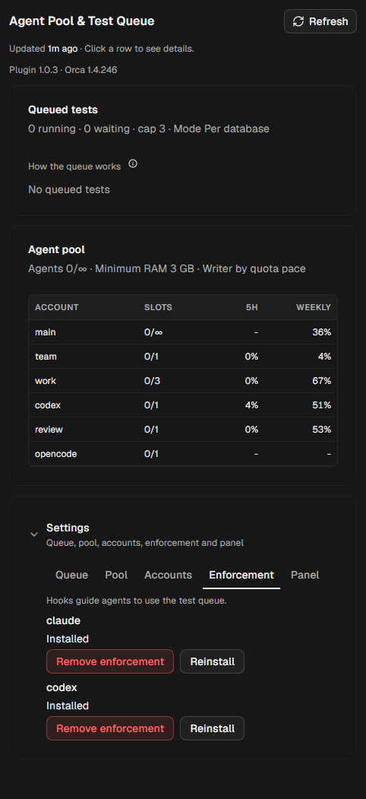

# Agent Pool & Test Queue for Orca

[](https://github.com/VictorStochero/orca-agent-pool/actions/workflows/ci.yml)


An [Orca](https://github.com/stablyai/orca) plugin that lets many coding agents share one machine safely. It gives you an **agent pool** (which account should do the next task, with slots per account), a **test queue** for any language (so parallel agents don't overload the machine or corrupt each other's test databases) and a **panel** in Orca to watch and configure both.


## Contents
- [Features](#features) · [Requirements](#requirements) · [Install](#install) · [How agents use it](#how-agents-use-it)
- [The panel](#the-panel) · [The test queue](#the-test-queue) · [Configuration](#configuration)
- [What it changes on your machine](#what-it-changes-on-your-machine) · [Quota and privacy](#quota-and-privacy)
- [CLI](#cli) · [Troubleshooting](#troubleshooting) · [Uninstall](#uninstall) · [Development](#development) · [Changelog](#changelog)

## Features
- **Agent pool**: your agent accounts (Claude Code, Codex, OpenCode, Antigravity, …) with **slots**, **weight** and **roles**. The writer for each task is the account with the most quota left × its weight, or the first one in your order. Accounts Orca already knows join automatically; extra CLIs, such as a second Claude login in its own `CLAUDE_CONFIG_DIR`, are added by hand.
- **Test queue**: every test run waits for its turn, per machine and per shared resource, for Laravel (artisan/Pest), Python (pytest), JavaScript/TypeScript (vitest, jest, npm/pnpm/yarn/bun), Go, Rust, .NET and RSpec.
- **Enforcement**: an optional hook for Claude Code and Codex that turns away a bare test command and tells the agent the queued form, so the rules hold even when an agent forgets them.
- **Panel**: tests waiting and running, the pool with quotas, alerts (for example an account that must log in again) and every setting, in English or Portuguese following Orca's language.
- Works with Orca's native orchestration (`orca orchestration worker-start`, `send`, `worker_done`).

## Requirements
- Orca **1.4.246** or newer. The plugin's CLI runs on Orca's own runtime: no separate Node.js, Python or Git Bash.
- Windows, macOS or Linux.

## Install
1. In Orca, open **Settings → Plugins** and install **Agent Pool & Test Queue** from the catalog.
   Not listed yet? Choose **Add plugin → From a Git URL…** and paste `https://github.com/VictorStochero/orca-agent-pool#v1.0.4`.
2. Approve the access it asks for (a trusted worker and its own storage).
3. Open the **Agent Pool** panel. On first activation the plugin:
   1. creates `~/.agents/agent-pool/` (`config.json` and `state/`);
   2. writes the launcher `~/.agents/bin/agent-pool` (plus `agent-pool.cmd` on Windows);
   3. installs the `agent-pool` skill into `~/.agents/skills/agent-pool` and links it into each detected agent's skills folder (a copy you edited is never overwritten);
   4. installs the enforcement hooks (see [below](#what-it-changes-on-your-machine)).

The panel stays on a **Requirements** screen until all of this is in place, including Orca's own `orchestration` skill, which it can install for you. Agents always call the launcher by its full path; add `~/.agents/bin` to your `PATH` if you want the short name `agent-pool` in your own terminal.

## How agents use it
The `agent-pool` skill teaches this to the agents; this is what a coordinator does around each worker:

```sh
# 1. pick the writer and reserve its slot (exit 75 = pool full: wait and try again)
~/.agents/bin/agent-pool writer --reserve task-42
#    → claude-b (pace 15.6 · 33% free, resets in 18h) · weight 5 · reserve res-task-42

# 2. start the worker on that account, then hand the slot to the real dispatch
orca orchestration worker-start ...
~/.agents/bin/agent-pool slot swap res-task-42 <dispatch-id>

# 3. inside the worker, every test goes through the queue
~/.agents/bin/agent-pool test -- php artisan test --filter=Orders

# 4. when the worker is done
~/.agents/bin/agent-pool slot release <dispatch-id>
```

A reservation that is never swapped expires after 10 minutes, and a slot whose dispatch Orca reports as finished is freed on the next read. With enforcement on, a bare `php artisan test` is refused with the exact command to run instead.

## The panel
| Settings · Accounts | Settings · Enforcement |
|---|---|
|  |  |

- **Tests in the queue**: what is running and waiting, per queue, with the process and how long it has waited.
- **Agent pool**: slots in use per account (`2/∞` for an account without its own limit), 5-hour and weekly quota, and the details of each account on click.
- **Settings**: tabs for the queue, the pool, the accounts (**Configure** an account or **Add** a custom one), **Enforcement** (install, reinstall or remove the hook per agent) and the panel itself.

## The test queue
Run tests with `agent-pool test` (detects the runner) or `agent-pool test -- <command>`.

| Mode | Behaviour |
|---|---|
| **Per database** (default) | one queue per shared resource. A database (`host:port/name`) gets one slot, so tests on the same database wait for each other and different databases run in parallel. The general queue and container runners use `fila.vagas` slots. |
| **Global** | one queue for the whole machine |
| **Per project** | one queue per project (`fila.vagas_projeto` slots each) |

The machine-wide cap (`fila.teto`) applies in every mode. The resource comes, in order, from the project's `.orca/agent-pool.json` (`{"recurso": "postgres:5433"}`), `DATABASE_URL`, `DB_HOST`/`DB_PORT`/`DB_DATABASE` (also when set inline, as in `DB_DATABASE=x php artisan test`), a container runner, or falls back to the general queue.

| Detected by | Runner | Parallelism (`fila.processos`) |
|---|---|---|
| `artisan` | `php artisan test` | `--parallel --processes=N` |
| `pyproject.toml` / `pytest.ini` / `requirements*.txt` | `pytest` (uv, poetry, pipenv or .venv) | `-n N` when pytest-xdist is installed |
| `package.json` | the `test` script (pnpm, yarn, bun or npm) | `--maxWorkers=N` |
| `go.mod` | `go test ./...` | `-p N` |
| `Cargo.toml` | `cargo test` | `-- --test-threads=N` |
| `*.csproj` / `*.sln` | `dotnet test` | `-m:N` |
| `Gemfile` + `spec/` | `rspec` | — |

After a parallel Laravel run the queue drops the `<database>_test_N` copies it created.

## Configuration
Everything is editable in the panel; the same keys work with `agent-pool config set key=value [key=value …]` (validated, all or nothing). Key names and values keep the plugin's original Portuguese names.

| Key | Values (default) | Meaning |
|---|---|---|
| `fila.modo` | `banco` (per database) · `global` · `projeto` | queue mode |
| `fila.vagas` | 1–99 (2) | slots per queue (general queue in `banco` mode) |
| `fila.vagas_projeto` | 1–99 (1) | slots per project in `projeto` mode |
| `fila.teto` | 1–99 (3) | tests at once on the machine |
| `fila.processos` | 1–64 (8) | parallel processes passed to the runner |
| `pool.teto` | 0–99 (0 = no cap) | workers at once on the machine |
| `pool.ram_min` | GB (0 = off) | free memory needed to reserve a new slot |
| `pool.escolha` | `ritmo` (quota pace × weight) · `ordem` (your order) | how the writer is picked |
| `pool.ordem` | account names, comma separated | the order used by `ordem` |
| `conta.<name>.vagas` | 0–99 (0 = no own limit) | slots of the account |
| `conta.<name>.peso` | 1–100 | weight in the writer choice |
| `conta.<name>.papeis` | `escritor`, `revisor`, `verificador`, `mecanico`, `segunda-opiniao`, `orquestra` | roles (writer, reviewer, verifier, mechanical, second opinion, coordinator) |
| `conta.<name>.ativo` | `sim` · `nao` | `nao` keeps the account listed and measured but gives it no new work |
| `conta.<name>.config` / `.comando` | a config folder (e.g. `~/.claude-work`) / a command | how the account's CLI is opened |
| `conta.<name>.adicionar` / `.remover` | agent id or `auto` / `1` | add a custom account / remove one |

## What it changes on your machine
The plugin runs as a **trusted worker** (Node.js with your user's access) and uses the plugin's own storage (`storage:own`). It writes only:

| Where | What | How to undo |
|---|---|---|
| `~/.agents/agent-pool/` | configuration, locks, waiting list, quota cache, backups | delete the folder |
| `~/.agents/bin/agent-pool[.cmd]` | the launcher | delete the file |
| `~/.agents/skills/agent-pool` + links | the skill | delete the folder and links |
| Claude Code `settings.json` (`hooks.PreToolUse`, matcher `Bash\|PowerShell`) in `~/.claude` and in the config folder of each Claude account of the pool | one hook that sends test commands through the queue | Settings → Enforcement → Remove |
| Codex `~/.codex/hooks.json` + hook trust in `~/.codex/config.toml` | the same hook for Codex | Settings → Enforcement → Remove |

Before the first write to an agent's config file the original is backed up to `~/.agents/agent-pool/state/backup/`. Our hook is recognized by its command (the launcher path followed by `hook claude` or `hook codex`); removing it leaves the rest of the file as it was. Files that are symbolic links stay links: the plugin writes to the link's target.

## Quota and privacy
- Accounts Orca manages use Orca's native quota (`orca account list`).
- Custom Claude accounts are measured with the account's own credentials file (`<CLAUDE_CONFIG_DIR>/.credentials.json`) against Anthropic's usage endpoint, falling back to `claude /usage`. The token is sent **only** to `api.anthropic.com`; it is never printed, logged or written anywhere.
- An account that is logged out shows **needs login** with the command to fix it, and is not picked for work.
- No telemetry: the plugin talks only to Orca, the agent CLIs and that usage endpoint.

## CLI
```
agent-pool test [-- command]                  run a test through the queue
agent-pool writer [--reserve <tag>]           pick the writer (and reserve its slot)
agent-pool second --family <family>           pick a second-opinion account of another model family
agent-pool slot take <account> <owner>        reserve a slot by hand
agent-pool slot swap <provisional> <dispatch> hand a reservation to the real dispatch
agent-pool slot release <dispatch> | free     free a slot | list free slots
agent-pool status [--json]                    queue and pool at a glance
agent-pool config get | set key=value …       read or change the configuration
agent-pool measure [account]                  measure quotas now
agent-pool doctor                             check config, Orca, launcher, skill and hooks
agent-pool hook <claude|codex>                the enforcement hook (called by the agents)
```
Exit codes: `0` ok, `2` invalid usage, `75` no slot or the wait ran out (try again).

## Troubleshooting
| Symptom | What to do |
|---|---|
| Something looks wrong | run `~/.agents/bin/agent-pool doctor`: every line should say `ok` |
| An agent says `agent-pool: command not found` | agents must call `~/.agents/bin/agent-pool` by its full path (the skill and the hook already do) |
| `exit 75` / "queue busy" | another test holds the slot of that resource, or the pool is full: wait and run again |
| An account shows **needs login** | log in with that account's CLI (the panel shows the command) |
| The panel is stuck on **Requirements** | install what it lists (it can install the skill and the hooks for you) |
| A test was refused by the hook | run the command the hook printed: `"…/agent-pool" test -- <your command>` |
| A test is shown as **stopped** | its process ended without freeing the slot; the next test that needs that slot takes it back |

## Uninstall
1. In the panel: **Settings → Enforcement → Remove** for each agent (this takes our hook out of the agents' config files).
2. In Orca: remove **Agent Pool & Test Queue** in **Settings → Plugins**.
3. Optionally delete `~/.agents/agent-pool/`, `~/.agents/bin/agent-pool*` and `~/.agents/skills/agent-pool` (plus its links in the agents' `skills` folders).

## Development
```sh
npm install
npm run typecheck
npm test               # core and CLI (node:test)
orca plugin test .     # worker and panel
npm run check          # orca plugin check against a throwaway home
orca plugin dev load . # load this folder into Orca (the real install)
```
- Never run `orca plugin check` bare: it starts the real worker, which writes the hooks, launcher and skill into your real home. `npm run check` runs it against a temporary home.
- `orca plugin dev load` and `dev watch` are a real install: the launcher points at this folder. Before deleting the folder, use **Remove** in Settings → Enforcement (or install the plugin from the catalog), or the agents' hook will call a launcher that no longer exists.
- Tests isolate `HOME` and `USERPROFILE`, and a guard fails the suite if it touches your real home.

## Changelog
- **1.0.4**: the panel no longer shows a false "Orca unavailable" and empty quotas when Orca restarts the idle worker (it shows the recorded quotas and "checking" until the first collection); a Claude account with an expired token is no longer reported as "usage unavailable" when `claude /usage` is slow (45 s timeout, then the usage endpoint with the renewed token).
- **1.0.3**: README with screenshots, usage flow, configuration reference, troubleshooting and uninstall.
- **1.0.2** (not published): version numbers aligned in every manifest (the `v1.0.1` tag shipped manifests still saying 1.0.0).
- **1.0.1**: Enforcement moved into Settings; Settings drawn as a card like the other sections.
- **1.0.0**: first release.

## License
[MIT](LICENSE)

---

## Português

Plugin do Orca que deixa vários agentes de código dividirem uma máquina com segurança: **pool de agentes** (contas com vagas, peso e papéis; o escritor de cada tarefa é a conta com mais cota sobrando × peso, ou a primeira da sua ordem), **fila de testes** para qualquer linguagem (por máquina e por recurso disputado, como o mesmo banco de testes), **imposição** opcional por hook no Claude Code e no Codex, e um **painel** no Orca, em português ou inglês conforme o idioma do Orca, com tudo configurável.

**Instalação:** pelo catálogo de plugins do Orca (Configurações → Plugins) ou por **Add plugin → From a Git URL…** com `https://github.com/VictorStochero/orca-agent-pool#v1.0.4`; aprove o acesso e abra o painel **Agent Pool**. O plugin grava só em `~/.agents/` (configuração, lançador `~/.agents/bin/agent-pool` e a skill) e instala o hook de imposição no Claude Code e no Codex, com backup antes e remoção em Configurações → Imposição.

**Uso pelos agentes:** `~/.agents/bin/agent-pool writer --reserve <tag>` antes do `worker-start`, `slot swap` para o dispatch real, `agent-pool test -- <comando>` para todo teste e `slot release` no fim. Contas Claude personalizadas são medidas com a credencial da própria conta, enviada só à API da Anthropic e nunca gravada ou exibida. Problemas: `~/.agents/bin/agent-pool doctor`. Os detalhes de modos da fila, executores, configuração e comandos estão nas seções em inglês acima.
